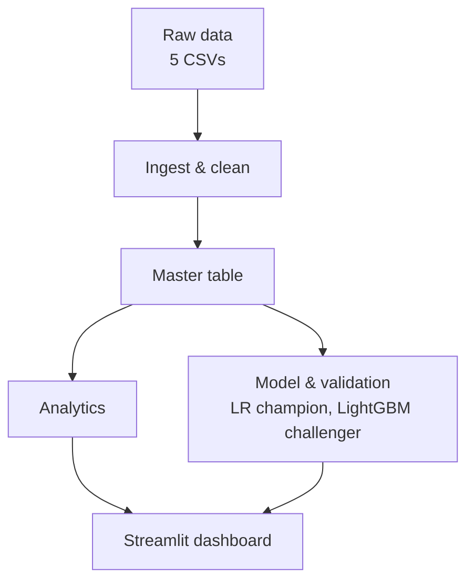
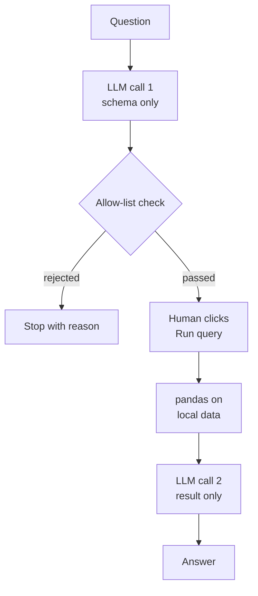

# Architecture

### Pipeline

### Ask the Portfolio

| Stage | What it does | Tools | Key outputs | Controls |
|---|---|---|---|---|
| Ingest and clean | Types dates, standardises labels, imputes with `_missing` flags, caps or flags anomalies | pandas, pyarrow | `data/processed/*.parquet`, [dq_notes.md](dq_notes.md) | Tests: row counts unchanged, PK unique, FK integrity, flag sums match raw null counts |
| Master table | Joins customers, loans, bureau aggregates and month 1–3 repayment aggregates; collections kept for analytics only | pandas | `master.parquet` (14,685 rows) | Tests: unique `account_id`, thin-file flag kept, repayment features use months ≤ 3 only |
| Analytics | Segment profiles, cross-tabs, exposure and defaulted-exposure shares | pandas | [insights.md](insights.md) | Tests: shares sum to 1, counts sum to 14,685 |
| Model | Month-3 default model: LR champion, LightGBM challenger, bureau sensitivity variant; deciles, risk bands, SHAP, PSI/CSI | scikit-learn, LightGBM, SHAP | `model_metrics.json`, scores, [model_report.md](model_report.md) | Time split on origination (train ≤ 2021); no collections features; imputers fit on train only; `gender` and `marital_status` excluded |
| Validation | Bootstrap CIs, grouped retrain, fairness table | scikit-learn, numpy | `validation.json` | Fixed seed; results reported as diagnostics, never tuned to a threshold |
| Dashboard | Portfolio, Model and Account views with filters; LR risk band and top-5 reason codes | Streamlit, plotly | `app/app.py` | Loader and filter tests; raw probability not shown |
| Ask the Portfolio | Question to a reviewed pandas query to a grounded answer | Anthropic API, pandas, `ast` | Query, result, answer | AST allow-list; empty builtins; human **Run query** click; 50-row cap; identifiers stripped before call 2; sees no rows in call 1; tested with a mocked LLM |

## Production path
What would change for a real bank (assumptions in [assumptions.md](assumptions.md)):
- **Scheduled pipeline:** an orchestrator runs ingest, master, scoring and validation on a schedule against
  governed source tables, with run logs and data-quality gates, replacing `python -m src.run_all`.
- **Model registry:** versioned models, features and risk-band thresholds, with approvals and a champion/challenger record.
- **Monitoring jobs:** monthly PSI/CSI, quarterly AUC/KS and calibration on matured vintages, with alerts
  per the plan in [model_report.md](model_report.md).
- **Access control:** authentication, role-based access to accounts and the Ask tab, audit logs of questions,
  queries and results.
- **Approved LLM endpoint:** a provider and data-sharing terms approved by the bank, hosted or routed as
  its policy requires; only the schema and aggregate results leave the environment.
